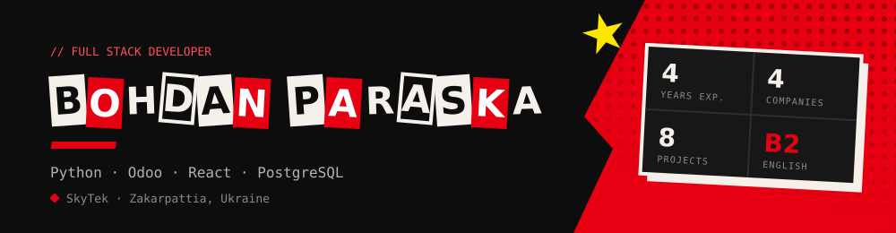
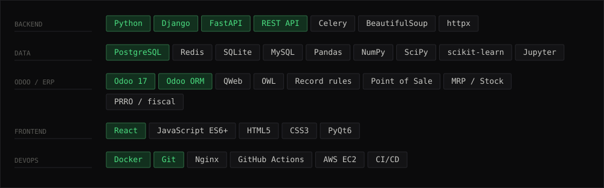

Python developer from Zakarpattia, Ukraine. Four years of backend work — Django and
FastAPI services, REST APIs, data pipelines and parsers — with React on the front when
a project needs one.

These days a good share of that Python goes into **Odoo**: custom ERP modules running
real shops, kitchens and a production floor. Same language, same ORM instincts, just a
far more opinionated framework wrapped around them.

I like the problems where third-party APIs, messy business processes and a clear
interface all have to meet in one place.

Українською

 

Python-розробник із Закарпаття. Чотири роки бекенду — сервіси на Django та FastAPI,
REST API, конвеєри обробки даних і парсери, плюс React на фронті, коли проєкт цього
потребує.

Останнім часом чимала частина цього Python іде в **Odoo**: кастомні ERP-модулі, на яких
працюють реальні магазини, кухні й виробничий цех. Та сама мова, ті самі звички роботи
з ORM — просто значно жорсткіший фреймворк навколо них.

Люблю задачі, де в одному місці сходяться чужі API, заплутані бізнес-процеси та
зрозумілий інтерфейс.

---

### What I do

**Backend and APIs.** Django and FastAPI services, RESTful API design, webhooks and
third-party integrations, authentication, user portals and admin back-offices. This is
the part I have been doing longest and reach for first.

**Data and automation.** Parsers that survive markup changes, pipelines over large data
sets, Redis caching, query tuning, scheduled jobs. Most of my commercial work has had a
data problem hiding somewhere inside it.

**ERP on Python — Odoo 17.** Custom modules for retail and POS (lot and serial tracking,
document chains, blocking negative-stock sales, fiscal receipts, excise) and a greenfield
manufacturing stack on native MRP/Stock/Sale with FEFO lot traceability and recipe cost
calculation. One rule I do not bend: never edit vendor code — everything is extended
through `_inherit`, `xpath` and our own modules.

**Frontend when it is needed.** React for platforms and landing pages, vanilla JS where a
framework would be overkill, PyQt6 when the thing belongs on the desktop.

---

### Stack

---

### Selected work

| Project | What it is | Built with |
| --- | --- | --- |
| **[vstup-tracker](https://github.com/ParaskaBohdan/vstup-tracker)** | Tracker for Ukrainian state-funded admission rankings — estimates your position by score and works out which competitors are real contenders | FastAPI · SQLite · httpx · Docker |
| **[haRdQualizer](https://github.com/ParaskaBohdan/haRdQualizer)** | Desktop audio visualiser you can punch — spectrum bars react to the mouse in real time. Custom engine with FFT and beat detection | PyQt6 · NumPy · SciPy · pyqtgraph |
| **[Chedryk_Landing](https://github.com/ParaskaBohdan/Chedryk_Landing)** | Site for a solar station and battery installer — scroll animations, two themes, ROI calculator, CI/CD | React · PHP · Docker |
| **[Diplom](https://github.com/ParaskaBohdan/Diplom)** | Bachelor thesis — k-nearest neighbours on Bitcoin price history, raw prices vs candlestick patterns | Python · scikit-learn · Jupyter |

Most of my commercial work lives in private repositories, so the public side here is
mainly pet projects and client sites.

---

### Where to find me

- **Email** — [bogdannparaska@gmail.com](mailto:bogdannparaska@gmail.com)
- **Location** — Zakarpattia, Ukraine · open to remote and hybrid
- **Languages** — Ukrainian (native) · English (B2)

<!-- Once the portfolio is deployed, drop the URL in here and uncomment:
- **Portfolio** — [bohdan.dev](https://bohdan.dev)
-->
